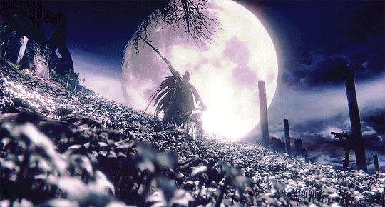

<!-- ============================================================
  𝔊𝔥𝔬𝔰𝔱 8-0-8 • GITHUB PROFILE
  Aesthetic: Dark Gothic / Ethereal Fantasy / Noir & Silver
============================================================ -->

<div align="center">
  
  <br><br>
  <h1>𓆩✧𓆪 𝔊𝔥𝔬𝔰𝔱 8-0-8 𓆩✧𓆪</h1>
</div>

<br>

<!-- ===== TYPING SVG (Cinzel / Ethereal) ===== -->
<div align="center">
  <a href="https://git.io/typing-svg">
    
  </a>
</div>

<br>

<!-- ===== BADGES NOIR & ARGENT ===== -->
<div align="center">
  
  <a href="https://github.com/Ghost8-0-8?tab=followers">
    
  </a>
  <a href="https://github.com/Ghost8-0-8?tab=repositories">
    
  </a>
</div>

<br>

<p align="center">
  
</p>

## 𓆩✧𓆪 ME

```bash
$ whoami
> Ghost8-0-8 — Fullstack AI Developer based in France
```
<p align="center">
  
</p>

## 𓆩✧𓆪 COMPETENCIES

<div align="center">

### † Languages


### ✧ Frameworks & Runtimes


### † Technology & DevOps


### ✧ Tools
 
</div>

<p align="center">
  
</p>

## 𓆩✧𓆪 METRICS

<div align="center">

  <!-- Top Languages (Tous les langages avec pourcentages - Thème Dark Gothic) -->
  
</div>

<br>

<div align="center">
  <!-- GitHub Streak Stats (Thème assorti Dark Gothic) -->
  
</div>

<p align="center">
  
</p>

<div align="center">
  <picture>
    <source media="(prefers-color-scheme: dark)" srcset="https://raw.githubusercontent.com/Ghost8-0-8/Ghost8-0-8/output/github-snake-dark.svg" />
    <source media="(prefers-color-scheme: light)" srcset="https://raw.githubusercontent.com/Ghost8-0-8/Ghost8-0-8/output/github-snake.svg" />
    
  </picture>
</div>

<br>

<p align="center">
  
</p>

